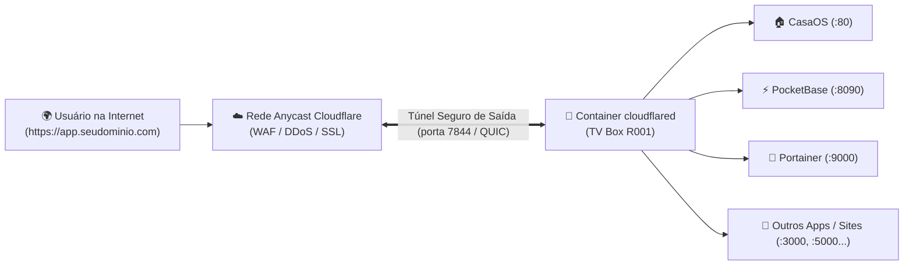

# ☁️ Manual do Cloudflare Tunnel — Acesso Externo Seguro

O **Cloudflare Tunnel (`cloudflared`)** é a tecnologia que conecta a sua TV Box à internet mundial com **criptografia HTTPS automática**, sem que você precise:
- Abrir portas no seu roteador (ignora CGNAT e duplo roteador);
- Expor o IP residencial da sua internet;
- Pagar por IP fixo ou DDNS;
- Configurar certificados SSL complicados (Let's Encrypt / Certbot).

Além disso, o `cloudflared` é extremamente leve e consome apenas **~25 a 30 MB de RAM**, respeitando perfeitamente o teto de 1 GB da nossa TV Box.

---

## ⚡ Como o Túnel Funciona na TV Box



Como o túnel cria uma **conexão de saída** da TV Box para a Cloudflare, seu firewall doméstico e roteador não precisam ter nenhuma porta aberta para a internet.

---

## 🛠️ Como o Container está Configurado

O container roda no Docker da TV Box com a política de reinício automático:

```bash
docker run -d \
  --name cloudflared \
  --restart unless-stopped \
  --network host \
  cloudflare/cloudflared:latest tunnel --no-autoupdate run --token <CLOUDFLARE_TUNNEL_TOKEN>
```

> 🔒 **Nota de Segurança:** O token real do túnel fica armazenado no arquivo local `CREDENCIAIS_LOCAIS.md` (ignorado pelo Git) para não vazar publicamente.

---

## 🌐 Como Apontar um Novo Site ou Painel (Passo a Passo)

Sempre que você quiser liberar o acesso de um app ou site que está rodando na TV Box para a internet:

1. Acesse o painel da Cloudflare: [dash.cloudflare.com](https://dash.cloudflare.com)
2. No menu lateral esquerdo, clique em **Zero Trust** ➡️ **Networks** ➡️ **Tunnels**.
3. Clique nos 3 pontinhos (`...`) ao lado do seu túnel (`tvbox-server`) e selecione **Configure**.
4. Vá na aba **Public Hostname** e clique em **`+ Add a public hostname`**.
5. Preencha os campos:
   * **Subdomain:** O prefixo desejado (ex.: `meusite`, `painel`, `api`, `pb`).
   * **Domain:** Escolha o seu domínio na lista (ex.: `seudominio.com`).
   * **Type:** `HTTP`
   * **URL:** `127.0.0.1:<PORTA_DO_APP>` (ou `tvbox.local:<PORTA_DO_APP>`).

### Exemplos Prontos de Roteamento:

| Para acessar... | Subdomínio no Cloudflare | Type | URL do Serviço |
| :--- | :--- | :--- | :--- |
| **Painel CasaOS** | `casaos.seudominio.com` | `HTTP` | `127.0.0.1:80` |
| **PocketBase (Banco & API)** | `pb.seudominio.com` | `HTTP` | `127.0.0.1:8090` |
| **Portainer (GitOps)** | `portainer.seudominio.com` | `HTTP` | `127.0.0.1:9000` |
| **Site HTML/JS no PocketBase** | `site.seudominio.com` | `HTTP` | `127.0.0.1:8090` |
| **Node-RED (Bots & Automação)** | `nodered.seudominio.com` | `HTTP` | `127.0.0.1:1880` |
| **App Novo via Portainer (ex: porta 3000)** | `app.seudominio.com` | `HTTP` | `127.0.0.1:3000` |

6. Clique em **Save hostname**. Em menos de 5 segundos, o endereço `https://seusubdominio.seudominio.com` estará acessível mundialmente com HTTPS verde! 🔒

---

## 🩺 Manutenção e Diagnóstico do Túnel

Se precisar verificar a saúde do túnel via SSH:

```bash
# 1. Verificar se o container está rodando e quanto de RAM consome
docker stats --no-stream cloudflared

# 2. Ver os logs de conexão com a Cloudflare
docker logs --tail 25 cloudflared

# 3. Reiniciar o túnel se necessário
docker restart cloudflared
```
