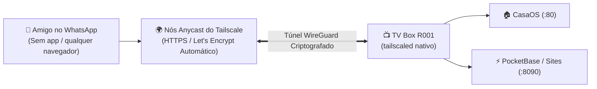

# 🔗 Manual do Tailscale Funnel — Link Fixo e Público Grátis

O **Tailscale Funnel** é a solução perfeita para quem quer compartilhar um site, aplicativo ou painel da TV Box com amigos e familiares **sem pagar nada por domínio**, **sem abrir portas no roteador** e com um **link permanente que nunca muda**, mesmo se a TV Box for desligada ou reiniciada.

---

## ⚡ Como o Funnel Funciona



* **Zero Instalação para Amigos:** Seus amigos não precisam instalar o app do Tailscale; eles abrem o link direto pelo navegador (Chrome, Safari, WhatsApp, etc.).
* **Certificado SSL Automático:** O link já abre com HTTPS verde oficial (via Let's Encrypt).
* **Link 100% Permanente:** Diferente de túneis temporários, esse endereço é fixo na sua conta.

---

## 🌐 Endereços Disponíveis na TV Box

Atualmente, a TV Box possui duas portas configuradas no Funnel:

| Serviço | Endereço de Acesso para Amigos | O que abre? |
| :--- | :--- | :--- |
| **CasaOS (Painel Geral)** | `https://<SEU_TAILNET>.ts.net/` | Painel web principal do servidor |
| **PocketBase (Sites e APIs)** | `https://<SEU_TAILNET>.ts.net:8443/` | Seus sites HTML/JS e painel de banco de dados |

> 🔒 **Nota de Privacidade:** O endereço real com seu identificador de conta fica armazenado no arquivo local `CREDENCIAIS_LOCAIS.md` (ignorado pelo Git).

---

## 🛠️ Comandos Rápidos de Gerenciamento (via SSH)

Se você quiser ver o status, alterar portas ou redirecionar um projeto novo para o link público:

```bash
# 1. Ver o status atual do Funnel e portas ativas
tailscale funnel status

# 2. Apontar o link principal (porta 443) para um projeto novo (ex: porta 3000)
tailscale funnel --bg --yes 3000

# 3. Expor uma segunda porta pública (ex: porta 8443 apontando para o PocketBase 8090)
tailscale funnel --https=8443 --bg 8090

# 4. Desativar o compartilhamento público do Funnel
tailscale funnel --https=443 off
tailscale funnel --https=8443 off
```

---

## 💡 Como Hospedar um Site para seus Amigos Verem (0 MB de RAM Extra)

1. No CasaOS, abra o app **Files** ➡️ `AppData` ➡️ `pocketbase` ➡️ `pb_public`.
2. Crie uma pasta para o seu site (ex: `jogo`).
3. Coloque seu `index.html` lá dentro.
4. Mande o link para seu amigo:
   ```text
   https://<SEU_TAILNET>.ts.net:8443/jogo/
   ```
O site abre imediatamente no celular dele, sem gastar nem 1 MB de memória RAM a mais na TV Box!
