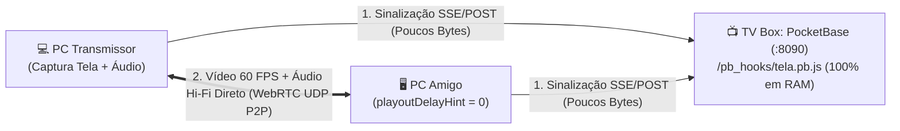

# 13 - TelaP2P: Servidor de Compartilhamento de Tela Zero Latência (WebRTC P2P)

[⬅️ Voltar para a Wiki Principal](../README.md) | [⬅️ Anterior: 12 - Manual do Tailscale Funnel](12-manual-tailscale-funnel.md)

O **TelaP2P** é a central própria de compartilhamento de tela da TV Box, criada como alternativa ultraleve e sem atraso ao Discord. Ela permite transmitir jogos, vídeos, janelas ou abas com áudio isolado em **60 FPS** consumindo **0 MB de RAM extra** e **0% de CPU de vídeo** na TV Box.

---

## ⚡ 1. Como Acessar e Usar com os Amigos

| Tipo de Acesso | Link de Entrada | O que permite fazer? |
| :--- | :--- | :--- |
| **Link Público HTTPS (Recomendado)** | `https://<SEU_TAILNET>.ts.net:8443/tela/` | **Transmitir sua tela** + Assistir + Chat (de qualquer lugar do mundo) |
| **Link Rede Local (LAN)** | `http://<IP_DA_TV_BOX>:8090/tela/` | **Assistir transmissões** + Chat na rede de casa |

> 💡 **Por que usar o link HTTPS (`:8443/tela/`) para transmitir?**
> Os navegadores modernos (Chrome, Edge, Brave, Firefox, Opera) exigem conexão segura (`https://`) para liberar o botão de captura de tela (`getDisplayMedia`). Como o **Tailscale Funnel** já entrega HTTPS oficial gratuito na porta `:8443`, basta abrir por ele!

### Passo a Passo para Entrar:
1. Abra o link `https://<SEU_TAILNET>.ts.net:8443/tela/`.
2. Digite o seu **Apelido (Nick)** e a **Senha da Sala** (salvos automaticamente no navegador após o primeiro acesso).
3. Para assistir um amigo que está com a tag `🔴 AO VIVO`, basta **clicar no nome dele** na lista da esquerda!

---

## 🔊 2. Transmissão Direta de Áudio (Sem Instalar Nada)

A transmissão de áudio funciona de forma **100% nativa e direta** pelo navegador, sem necessidade de instalar nenhum driver, plugin ou programa externo:

### Como funciona no navegador:
1. **Transmitir com Áudio (Tela Inteira, Janela ou Aba):**
   * Ao clicar em **"🖥️ Compartilhar Minha Tela"**, o prompt nativo do navegador abrirá.
   * **Tela Inteira:** Marque a caixinha **"Compartilhar áudio do sistema"** no rodapé do prompt para enviar o som direto do PC com áudio Estéreo 48 kHz sem filtros de abafamento.
   * **Guia do Navegador (Aba):** Se você escolher uma aba específica (ex.: YouTube, Twitch, Netflix), o navegador isola nativamente apenas o áudio daquela aba.
2. **🔇 Sem Áudio (Somente Imagem):**
   * Se quiser transmitir apenas vídeo, mude para "Sem Áudio" no menu de engrenagem (`⚙️`).
3. **Controle de Privacidade Instantâneo na Live:**
   * Durante a transmissão, você tem o botão **`🔊 Áudio Live: ON`** no dock inferior.
   * Basta clicar nele para mutar/desmutar o áudio no mesmo milissegundo, acompanhando o medidor de volume visual (**VU Meter**) em tempo real.

---

## 🎛️ 3. Controle de Qualidade, FPS e Latência Zero

Você pode trocar a qualidade **antes** ou **durante a transmissão ao vivo** (sem desconectar quem está assistindo):

* **Presets de 1 Clique:**
  * `🪶 Leve (480p)`: `480p @ 24 FPS` (`0.9 Mbps`) — para internet móvel ou PC fraco.
  * `⚖️ 720p 30fps`: `720p @ 30 FPS` (`2.5 Mbps`) — equilíbrio ideal.
  * `🎮 720p 60fps`: `720p @ 60 FPS` (`4.5 Mbps`) — fluidez total para jogos.
  * `🔥 1080p 60fps`: `1080p @ 60 FPS` (`7.0 Mbps`) — qualidade máxima.
* **Otimização de Imagem (`contentHint`):**
  * **⚡ Zero Atraso / Movimento:** Prioriza manter os `60 FPS` constantes (`maintain-framerate`) sem acumular fila de quadros.
  * **📄 Nitidez de Texto:** Prioriza resolução cristalina (`maintain-resolution`) para ler códigos, planilhas ou textos pequenos.
* **Receptor de Latência Zero (`playoutDelayHint = 0`):**
  * O player desativa o buffer de atraso padrão do navegador e exibe no topo o **Ping real (`ms`)**, **FPS**, **Resolução** e **Bitrate**, além de contar com o botão **`⚡ Zerar Delay`** e **Amplificador de Volume até 200% (`Boost`)**.

---

## 🛠️ 4. Arquitetura Técnica na TV Box (0 MB RAM / 0 Escrita em Disco)



* **Onde ficam os arquivos na TV Box:**
  * Front-end estático: `/DATA/AppData/pocketbase/pb_public/tela/index.html`
  * Motor de sinalização em RAM: `/DATA/AppData/pocketbase/pb_hooks/tela.pb.js` (montado em `/pb_hooks/tela.pb.js`)
  * Senha configurada da sala: `/DATA/AppData/pocketbase/pb_data/tela_pass.txt`
* **Como trocar a senha da sala via SSH quando quiser:**
  ```bash
  echo "nova_senha_aqui" > /DATA/AppData/pocketbase/pb_data/tela_pass.txt
  ```
  *(A troca é instantânea, sem precisar reiniciar o PocketBase!)*
