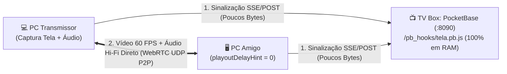

# 13 - TelaP2P: Servidor de Compartilhamento de Tela Zero Latência (WebRTC P2P)

[⬅️ Voltar para a Wiki Principal](../README.md) | [⬅️ Anterior: 12 - Manual do Tailscale Funnel](12-manual-tailscale-funnel.md)

O **TelaP2P** é a central própria de compartilhamento de tela da TV Box, criada como alternativa ultraleve e sem atraso ao Discord. Ela permite transmitir jogos, vídeos, janelas ou abas com áudio isolado em **60 FPS** consumindo **0 MB de RAM extra** e **0% de CPU de vídeo** na TV Box.

---

## ⚡ 1. Como Acessar e Usar com os Amigos

| Tipo de Acesso | Link de Entrada | O que permite fazer? |
| :--- | :--- | :--- |
| **Link Público HTTPS (Recomendado)** | `https://<SEU_TAILNET>.ts.net:8443/tela/` | **Transmitir sua tela** + Assistir + Chat (de qualquer lugar do mundo) |
| **Link Rede Local (LAN)** | `http://<IP_DA_TV_BOX>:8090/tela/` | **Assistir transmissões** + Chat na rede de casa |

> 💡 **Por que usar o link HTTPS (`:8443/tela/`) para transmitir?**
> Os navegadores modernos (Chrome, Edge, Brave, Firefox, Opera) exigem conexão segura (`https://`) para liberar o botão de captura de tela (`getDisplayMedia`). Como o **Tailscale Funnel** já entrega HTTPS oficial gratuito na porta `:8443`, basta abrir por ele!

### Passo a Passo para Entrar:
1. Abra o link `https://<SEU_TAILNET>.ts.net:8443/tela/`.
2. Digite o seu **Apelido (Nick)** e a **Senha da Sala** (salvos automaticamente no navegador após o primeiro acesso).
3. Para assistir um amigo que está com a tag `🔴 AO VIVO`, basta **clicar no nome dele** na lista da esquerda!

---

## 🔊 2. Como Funciona o Áudio no Navegador & Como Isolar o Som do Jogo sem Vazar o Discord

Navegadores web (Chrome, Edge, Brave, Opera) rodam dentro de uma camada de segurança restrita (*sandbox*). Por isso, existem regras específicas de como o áudio do Windows é capturado:

### Por que quando compartilha Tela Inteira "vai geral" (ou ficava sem áudio)?
1. **Captura do Dispositivo Padrão (Stereo Mix):** Quando o navegador captura o áudio do sistema na Tela Inteira, ele escuta a **saída geral do seu fone de ouvido**. Tudo que você estiver ouvindo (o jogo, as vozes dos seus amigos no Discord, notificações do Windows e cliques) é capturado junto, gerando eco para quem está na call.
2. **A trava do `systemAudio: "exclude"`:** Versões anteriores ativavam `systemAudio: "exclude"` para tentar proteger de eco, mas isso fazia o Chrome **silenciar 100% da tela inteira**. Agora, o modo de tela inteira opera com `systemAudio: "include"`, garantindo que o áudio seja transmitido com alta fidelidade estéreo sem cancelamento de frequências de graves/jogos.

---

### 🎯 Os 3 Modos de Áudio Disponíveis no TelaP2P:

No menu de engrenagem (`⚙️`) ou na barra inferior do dock, você escolhe como transmitir seu som:

1. **🖥️ Áudio da Janela ou Tela (Padrão):**
   * **Tela Inteira:** Captura o áudio do Windows (marque a caixinha *"Compartilhar áudio do sistema"* no prompt do navegador).
   * **Guia do Navegador:** O navegador consegue isolar com precisão cirúrgica apenas o som daquela aba (ex.: YouTube, Twitch, Netflix).
2. **🎛️ Canal Isolado / Cabo Virtual (ISOLAR O JOGO SEM ECO DO DISCORD):**
   * Puxa o áudio de um canal de entrada específico do Windows (como um driver virtual).
   * Permite transmitir **exclusivamente o jogo**, deixando o Discord e os sons do Windows apenas no seu ouvido!
3. **🔇 Sem Áudio (Somente Imagem):**
   * Transmissão 100% muda para focar apenas em vídeo.

---

### 💡 O Segredo dos Pro-Players: Como Isolar Só o Jogo com o VB-CABLE (1 Minuto)

Para transmitir o som do seu jogo sem vazar a chamada do Discord e sem capturar notificações do Windows:

1. **Baixe o driver gratuito VB-CABLE:**
   * Acesse [vb-audio.com/Cable](https://vb-audio.com/Cable/) e instale o driver virtual de áudio (reinicie o PC se solicitado).
2. **Direcione a saída do Jogo para o Cabo:**
   * No Windows 10/11, abra: `Configurações > Sistema > Som > Opções de som avançadas / Volume de apps e preferências do dispositivo`.
   * Na linha do executável do seu **Jogo**, mude o dispositivo de **Saída** de *"Padrão"* para **`CABLE Input (VB-Audio Virtual Cable)`**.
3. **Para você continuar ouvindo o jogo no seu fone ao mesmo tempo:**
   * Pressione `Win + R`, digite `mmsys.cpl` e dê Enter (abre o Painel de Controle de Som clássico).
   * Vá na aba **Gravação**, clique duas vezes em **`CABLE Output`**, abra a aba **Escutar**.
   * Marque a caixinha **"Escutar o dispositivo"** e selecione o seu **Fone de Ouvido** na lista de reprodução. Clique em *OK*.
4. **No TelaP2P:**
   * No menu de áudio da transmissão, selecione **`🎛️ Canal Isolado / Cabo Virtual`** e escolha **`CABLE Output`**.
   * **Resultado:** Seus amigos ouvirão apenas o áudio limpo do jogo em estéreo 48 kHz, enquanto a conversa do Discord fica isolada no seu fone!

### 🔄 Troca de Áudio em Tempo Real Durante a Live:
O TelaP2P suporta **troca de faixa de áudio sem reiniciar a live** (`replaceTrack`). Se você começou a transmitir a tela e esqueceu de ligar o áudio ou quer alternar entre o Cabo Virtual e o Mudo, basta mudar no menu: a troca é instantânea para todos os amigos conectados, sem congelar a imagem!

---

## 🎛️ 3. Controle de Qualidade, FPS e Latência Zero

Você pode trocar a qualidade **antes** ou **durante a transmissão ao vivo** (sem desconectar quem está assistindo):

* **Presets de 1 Clique:**
  * `🪶 Leve (480p)`: `480p @ 24 FPS` (`0.9 Mbps`) — para internet móvel ou PC fraco.
  * `⚖️ 720p 30fps`: `720p @ 30 FPS` (`2.5 Mbps`) — equilíbrio ideal.
  * `🎮 720p 60fps`: `720p @ 60 FPS` (`4.5 Mbps`) — fluidez total para jogos.
  * `🔥 1080p 60fps`: `1080p @ 60 FPS` (`7.0 Mbps`) — qualidade máxima.
* **Otimização de Imagem (`contentHint`):**
  * **⚡ Zero Atraso / Movimento:** Prioriza manter os `60 FPS` constantes (`maintain-framerate`) sem acumular fila de quadros.
  * **📄 Nitidez de Texto:** Prioriza resolução cristalina (`maintain-resolution`) para ler códigos, planilhas ou textos pequenos.
* **Receptor de Latência Zero (`playoutDelayHint = 0`):**
  * O player desativa o buffer de atraso padrão do navegador e exibe no topo o **Ping real (`ms`)**, **FPS**, **Resolução** e **Bitrate**, além de contar com o botão **`⚡ Zerar Delay`** e **Amplificador de Volume até 200% (`Boost`)**.

---

## 🛠️ 4. Arquitetura Técnica na TV Box (0 MB RAM / 0 Escrita em Disco)



* **Onde ficam os arquivos na TV Box:**
  * Front-end estático: `/DATA/AppData/pocketbase/pb_public/tela/index.html`
  * Motor de sinalização em RAM: `/DATA/AppData/pocketbase/pb_hooks/tela.pb.js` (montado em `/pb_hooks/tela.pb.js`)
  * Senha configurada da sala: `/DATA/AppData/pocketbase/pb_data/tela_pass.txt`
* **Como trocar a senha da sala via SSH quando quiser:**
  ```bash
  echo "nova_senha_aqui" > /DATA/AppData/pocketbase/pb_data/tela_pass.txt
  ```
  *(A troca é instantânea, sem precisar reiniciar o PocketBase!)*
