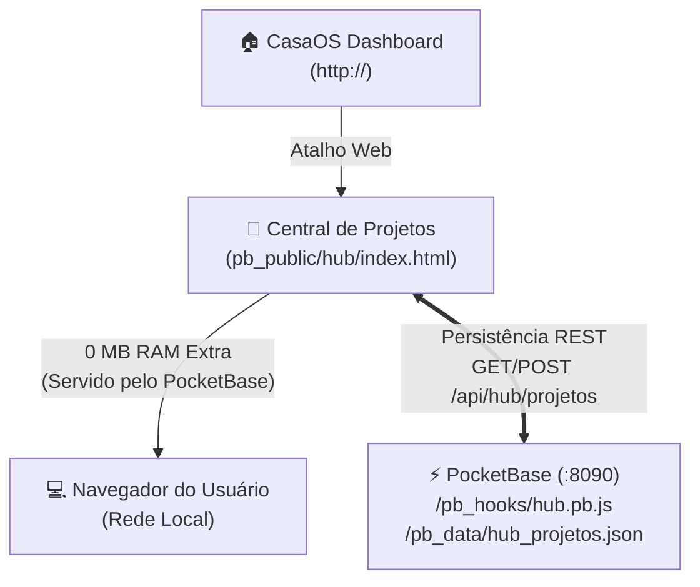

# 14 - Manual da Central de Projetos (Hub Local de Links e Informações)

[⬅️ Voltar para a Wiki Principal](../README.md) | [⬅️ Anterior: 13 - TelaP2P WebRTC](13-servidor-compartilhamento-tela-webrtc.md)

A **Central de Projetos (Hub)** é o portal privado da sua TV Box criado especificamente para reunir todos os seus projetos, bancos, automações e servidores em um único lugar, permitindo visualizar **lado a lado o Link Local (LAN), o Link Público (Internet) e anotações/credenciais**, visível **exclusivamente na sua rede local** com **0 MB de memória RAM adicional**.

---

## ⚡ 1. Como Acessar a Central de Projetos

* **Acesso Direto pelo Navegador (Recomendado via mDNS):**  
  `http://tvbox.local:8090/hub/` *(nunca muda mesmo se o roteador trocar o IP!)*
* **Pelo CasaOS:**  
  Basta clicar no ícone **🚀 Central de Projetos** na tela inicial do CasaOS (`http://tvbox.local`).

> 💡 **Por que usamos `http://tvbox.local` nos links locais?**  
> Porque o roteador pode renovar ou trocar o IP local (DHCP) a qualquer momento. Usando o nome de domínio local `tvbox.local` (resolvido automaticamente via mDNS / Avahi), todos os seus links e favoritos continuam funcionando perfeitamente para sempre sem você precisar reconfigurar nada!

---

## 🏠 2. Como Adicionar o Atalho no CasaOS (Passo a Passo)

Para deixar a Central de Projetos com um botão oficial e bonito na tela inicial do CasaOS:

1. Acesse o **CasaOS** (`http://tvbox.local`);
2. Na seção de aplicativos, clique no botão **`+`** (no canto superior direito da lista de apps);
3. Selecione a opção **`Adicionar link externo`** (Add link / atalho web);
4. Preencha os campos:
   * **Nome do App:** `🚀 Central de Projetos`
   * **URL:** `http://tvbox.local:8090/hub/`
   * **Ícone (URL):**  
     `https://cdn-icons-png.flaticon.com/512/3242/3242257.png` *(ou escolha um ícone do CasaOS)*
5. Clique em **`OK` / `Salvar`**.
6. Pronto! Agora você tem um atalho oficial na grade do CasaOS que abre sua Central de Projetos com 1 clique!

---

## 📋 3. O que Cada Card de Projeto Mostra

Para cada projeto cadastrado, o painel exibe:

```
┌─────────────────────────────────────────────────────────────────┐
│ 🖥️ TelaP2P (Live Stream 60 FPS)       [WebRTC] [🟢 Online]  ✏️ │
├─────────────────────────────────────────────────────────────────┤
│ Compartilhamento de tela e áudio com latência zero e 60 FPS.    │
│ ⚙️ Porta 8090/tela/ (LAN) e 8443 (Funnel) | Consumo: 0 MB RAM   │
│ 📌 Nota: Senha padrão da sala: 123456                           │
├─────────────────────────────────────────────────────────────────┤
│ 🏠 LINK LOCAL (LAN):                                            │
│ [ http://tvbox.local:8090/tela/               ] [Copiar] [Abrir]│
│                                                                 │
│ 🌐 LINK PÚBLICO (AMIGOS):                                       │
│ [ https://tvbox.tailb6e36d.ts.net:8443/tela/   ] [Copiar] [Abrir]│
└─────────────────────────────────────────────────────────────────┘
```

* **Links com 1 Clique:**
  * **Link Local (LAN):** Abre diretamente no IP da sua casa com latência mínima.
  * **Link Público:** Abre a versão pública do projeto (via Tailscale Funnel ou Cloudflare Tunnel). Se o projeto for estritamente interno, exibe a etiqueta `🔒 Apenas Acesso Local`.
  * **Botão Copiar:** Copia a URL instantaneamente para colar no Discord, WhatsApp ou terminal.
* **Informações e Anotações:** Porta utilizada, consumo aproximado de RAM e campo de notas para credenciais de teste ou senhas.

---

## 🛠️ 4. Como Adicionar ou Editar Novos Projetos

Você não precisa mexer em arquivos nem digitar comandos no terminal para cadastrar novos projetos:

1. No topo da Central de Projetos, clique no botão azul **`+ Novo Projeto`**;
2. Escolha um emoji ou ícone (🚀, 🖥️, ⚡, 🧩, 🐳, 🤖, 🎮...);
3. Digite o nome, categoria e status (🟢 *Online*, 🟡 *Em Dev*, ⏸️ *Pausado*);
4. Clique em **`✨ Preencher IP Local`** para inserir automaticamente o IP atual da TV Box na porta que você escolher;
5. Se o projeto tiver um link público (Tailscale Funnel ou Cloudflare), cole no campo de link público;
6. Adicione notas ou credenciais de teste caso queira ter um lembrete rápido;
7. Clique em **`Salvar Projeto`**!

> 💾 **Sincronização Automática:**  
> Ao salvar, o projeto é gravado na hora no arquivo de dados da TV Box (`/DATA/AppData/pocketbase/pb_data/hub_projetos.json`) e guardado no cache do seu navegador. Todas as máquinas na rede que abrirem o link verão as mesmas atualizações.
> 
> Você também pode clicar no botão **`💾 Backup`** no topo para baixar um arquivo JSON com todos os seus projetos salvos.

---

## ⚙️ 5. Arquitetura Técnica (0 MB de RAM Extra)



* **Front-end:** Arquivo HTML5 único (`/DATA/AppData/pocketbase/pb_public/hub/index.html`), responsivo, estilizado em *dark mode* nativo com tipografia moderna.
* **Motor de API:** PocketBase Hook (`/DATA/AppData/pocketbase/pb_hooks/hub.pb.js`), executado diretamente na máquina virtual JavaScript existente do PocketBase (sem criar novos processos ou containers).
* **Armazenamento:** Arquivo `/DATA/AppData/pocketbase/pb_data/hub_projetos.json` gravado diretamente no HD blindado de 1 TB.
