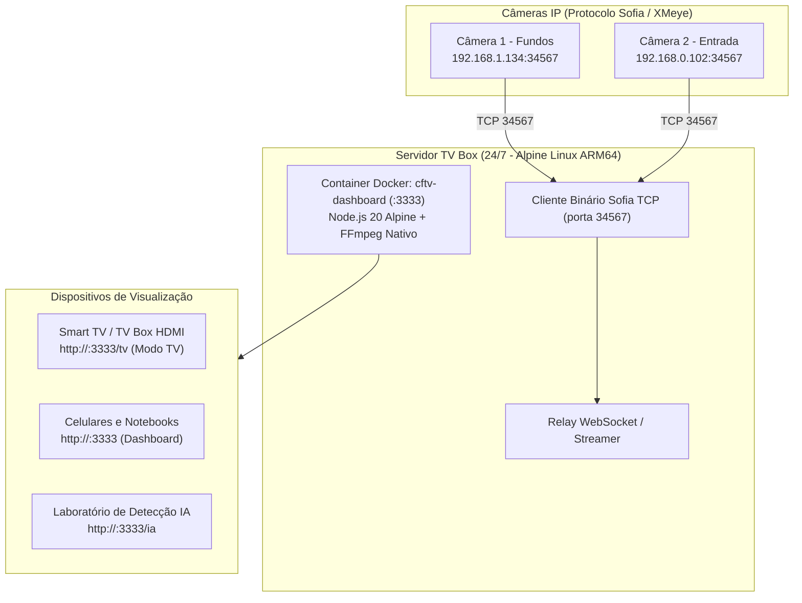

# 18 - Manual do Projeto CFTV Dashboard (Monitoramento de Câmeras Locais e Modo TV)

[⬅️ Voltar para a Wiki Principal](../README.md) | [⬅️ Anterior: 17 - Manual do File Browser](17-manual-filebrowser-drive-pessoal.md)

---

## 📹 O que é o CFTV Dashboard?

O **CFTV Dashboard** é uma central de monitoramento web moderna, leve e 100% local para visualização em tempo real das câmeras de segurança (**Fundos** e **Entrada**). 

Ele elimina a dependência de aplicativos legados da XMeye e nuvens externas, funcionando diretamente em qualquer navegador moderno (Chrome, Edge, Smart TV, celular) via WebSockets e renderização acelerada por hardware em `<canvas>`.



---

## ⚡ Por que Hospedar o CFTV na Mini-VPS TV Box?

1. **Servidor 24/7 Econômico:** Em vez de deixar seu computador pessoal ligado o dia todo consumindo energia, a TV Box fica ligada na tomada consumindo apenas ~3 Watts.
2. **Na Mesma Rede das Câmeras:** A TV Box já está cabeada ou conectada no Wi-Fi da sua casa, acessando diretamente os IPs locais das câmeras.
3. **Modo TV Instantâneo (`/tv`):** A TV Box pode transmitir as câmeras direto para a TV da sala ou quarto via HDMI, ou qualquer Smart TV conectada na rede local.

---

## 🧱 Arquitetura e Otimização para 1 GB de RAM

O CFTV Dashboard roda sob o **Padrão 3 (Container Dedicado em Alpine)** da nossa arquitetura:

| Parâmetro | Configuração na TV Box |
| :--- | :--- |
| **Imagem Base** | `node:20-alpine` com pacote `ffmpeg` nativo ARM64 |
| **Consumo de RAM Médio** | ~60 MB a 110 MB (dependendo de conexões ativas) |
| **Limite Rígido (`mem_limit`)** | `180M` (garante que nunca trave o sistema operacional) |
| **Reserva (`mem_reservation`)**| `80M` |
| **Porta Externa** | `:3333` |
| **Caminho no Repositório** | `projetos/cftv-dashboard/` |

> [!NOTE]
> **Compatibilidade Multiplataforma do FFmpeg:**  
> O código original apontava para `ffmpeg.exe` (Windows). No repositório da TV Box, foi implementado o módulo `server/ffmpeg-path.js`, que detecta automaticamente a variável `FFMPEG_PATH=ffmpeg` dentro do Linux Alpine ARM64, mantendo o suporte transparente tanto no Windows quanto no Linux.

---

## 🚀 Como Subir o CFTV Dashboard na TV Box

### Opção 1: Via Portainer GitOps (Recomendado)
1. Acesse o **Portainer** (`http://<IP_DA_TV_BOX>:9000` ou pelo CasaOS).
2. Vá em **Stacks** ➡️ **+ Add stack** ➡️ selecione **Repository**.
3. Preencha os campos:
   * **Name:** `cftv-dashboard`
   * **Repository URL:** `https://github.com/jonathanbrum/servidor-tv-box.git`
   * **Repository reference:** `refs/heads/main`
   * **Compose path:** `projetos/cftv-dashboard/docker-compose.yml`
4. Na seção **Environment variables**, adicione as variáveis com as credenciais das suas câmeras:
   * `PORT`: `3333`
   * `CAM1_NAME`: `Fundos`
   * `CAM1_HOST`: `192.168.1.134`
   * `CAM1_PORT`: `34567`
   * `CAM1_USER`: `admin`
   * `CAM1_PASS`: `<SUA_SENHA_CAM1>`
   * `CAM2_NAME`: `Entrada`
   * `CAM2_HOST`: `192.168.0.102`
   * `CAM2_PORT`: `34567`
   * `CAM2_USER`: `admin`
   * `CAM2_PASS`: `<SUA_SENHA_CAM2>`
5. Ative **Automatic updates** (Polling a cada 5m ou Webhook) e clique em **Deploy the stack**.

---

### Opção 2: Via Terminal SSH / Docker Compose Direto
Se preferir rodar direto no HD externo (`/DATA/AppData/cftv-dashboard`):

1. Conecte via SSH:
   ```bash
   ssh root@<IP_DA_TV_BOX>
   ```
2. Crie a pasta do projeto no HD externo e entre nela:
   ```bash
   mkdir -p /DATA/AppData/cftv-dashboard
   cd /DATA/AppData/cftv-dashboard
   ```
3. Copie os arquivos da pasta `projetos/cftv-dashboard` do seu PC para a TV Box (ou clone o repositório).
4. Crie o arquivo `.env` com suas senhas reais:
   ```bash
   nano .env
   ```
5. Inicie o container:
   ```bash
   docker compose up -d --build
   ```

---

## 📱 Telas e Modos de Uso

| Tela | Endereço Web | Finalidade |
| :--- | :--- | :--- |
| **Dashboard Completo** | `http://<IP_DA_TV_BOX>:3333/` | Visão geral das câmeras, zoom digital, captura de fotos e controles. |
| **Modo TV (Tela Cheia)** | `http://<IP_DA_TV_BOX>:3333/tv` | Modo limpo, 100% tela cheia, OSD grande legível à distância e anti-descanso de tela. |
| **Laboratório de IA** | `http://<IP_DA_TV_BOX>:3333/ia` | Detecção de pessoas, carros e motos com zonas de interesse (ROI) e alertas. |

---

## 🔒 Segurança e Sanitização das Câmeras

> [!IMPORTANT]
> O arquivo `.env` e as configurações da Tuya (`tuya-config.json`) estão listados no `.gitignore` e **nunca sobem para o GitHub público**. As senhas das câmeras ficam restritas exclusivamente à memória do container na sua rede interna.
