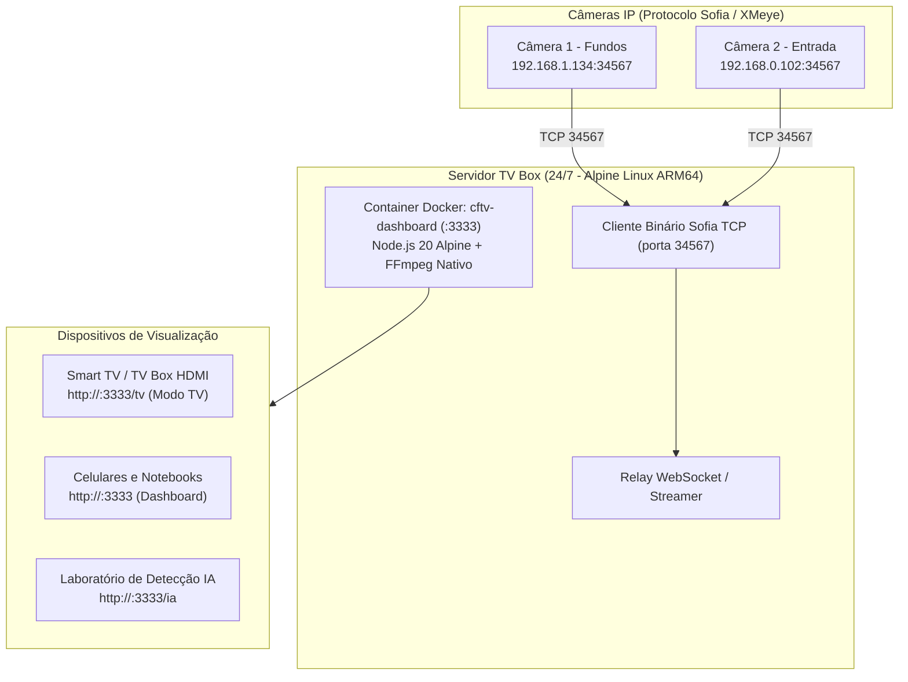

# 18 - Manual do Projeto CFTV Dashboard (Monitoramento de Câmeras Locais e Modo TV)

[⬅️ Voltar para a Wiki Principal](../README.md) | [⬅️ Anterior: 17 - Manual do File Browser](17-manual-filebrowser-drive-pessoal.md)

---

## 📹 O que é o CFTV Dashboard?

O **CFTV Dashboard** (versão 2.0 Command Center) é uma central de monitoramento web moderna, tática, leve e 100% local para visualização em tempo real das câmeras de segurança (**Fundos** e **Entrada**). 

Desenvolvida com arquitetura moderna baseada em **Vite + React 19 + TypeScript + Tailwind CSS v4**, a interface elimina a dependência de aplicativos legados da XMeye e nuvens externas, funcionando com renderização acelerada em `<canvas>` via WebSockets / JSMpeg e servida por um backend enxuto Node.js 20 Alpine.

Possui 5 visões operacionais integradas:
1. **Monitoramento ao Vivo:** Visualização em Split 2 ou tela individual, telemetria em tempo real (FPS e ping), controles de zoom digital, captura de snapshot instantâneo e maximização.
2. **Modo TV (Wallboard / 10-Foot UI):** Interface adaptada para Smart TVs e monitores HDMI via rota `#tv`, suporte nativo a WakeLock API (bloqueio de descanso de tela), relógio gigante e menu flutuante.
3. **Vigia IA & Cerca Virtual:** Traçado de cerca virtual poligonal sobre o feed ao vivo ou amostra gravada, detecção inteligente de classes (Pessoas, Carros, Motos, Animais), sensibilidade ajustável, alertas por permanência e gatilhos de sirene/webhook.
4. **Gravações (Playback):** Consulta no armazenamento local/SD por câmera e data, player de reprodução com timeline interativa, download direto em MP4 e atalho de reanálise na IA.
5. **Diagnóstico de Rede:** Tabela de conectividade TCP/RTSP das câmeras, cálculo de latência média, botão de reteste individual ou geral e guia interativo para sub-redes híbridas.



---

## ⚡ Por que Hospedar o CFTV na Mini-VPS TV Box?

1. **Servidor 24/7 Econômico:** Em vez de deixar seu computador pessoal ligado o dia todo consumindo energia, a TV Box fica ligada na tomada consumindo apenas ~3 Watts.
2. **Na Mesma Rede das Câmeras:** A TV Box já está cabeada ou conectada no Wi-Fi da sua casa, acessando diretamente os IPs locais das câmeras.
3. **Modo TV Instantâneo (`/tv`):** A TV Box pode transmitir as câmeras direto para a TV da sala ou quarto via HDMI, ou qualquer Smart TV conectada na rede local.

---

## 🧱 Arquitetura e Otimização para 1 GB de RAM

O CFTV Dashboard roda sob o **Padrão 3 (Container Dedicado em Alpine)** da nossa arquitetura:

| Parâmetro | Configuração na TV Box |
| :--- | :--- |
| **Imagem Base** | `node:20-alpine` com pacote `ffmpeg` nativo ARM64 |
| **Consumo de RAM Médio** | ~45 MB a 90 MB (dependendo de conexões ativas) |
| **Limite Rígido de RAM (`mem_limit`)** | `180M` (garante que nunca trave o sistema operacional) |
| **Limite Rígido de CPU (`cpus`)** | `1.5` (impede que o transcode sature os 4 núcleos do H313) |
| **Reserva (`mem_reservation`)**| `80M` |
| **Modo Padrão de Exibição** | `🍃 ECO 1s` (Snapshots JPEG nativos a cada 1s via porta 34567) |
| **Porta Externa** | `:3333` |
| **Caminho no Repositório** | `projetos/cftv-dashboard/` |

> [!TIP]
> **Engenharia Térmica e Dual-Mode (ECO vs Stream ao Vivo):**  
> O H313 possui 4 núcleos Cortex-A53 com refrigeração passiva. Rodar transcode contínuo de vídeo 25 FPS para duas câmeras simultâneas no FFmpeg atinge 100% de CPU e aquece a placa a mais de 95°C. Por isso, o sistema implementa a arquitetura **Dual-Mode**:
> 1. **Modo ECO (Padrão):** As câmeras geram fotos JPEG nativas diretamente no seu chip DSP interno via comando Sofia `OPSNAP` (porta 34567) a cada 1 ou 2 segundos. O uso de CPU na TV Box cai para **menos de 2%** e a temperatura fica fria e estável em **~53°C**, ideal para deixar telas e TVs abertas o dia inteiro.
> 2. **Modo Stream (25 FPS sob demanda):** Caso o usuário selecione `HD 1080p` ou `SD Econômico`, o streaming contínuo via FFmpeg/JSMpeg é ativado apenas durante a visualização e desliga sozinho assim que o usuário fecha a tela ou volta para o modo ECO.
> 3. **Modo Encomenda / Vigia Temporário:** Temporizador inteligente com janelas de **30m, 1h, 2h, 4h, 8h até 12h** com contagem regressiva e desligamento automático, perfeito para aguardar entregas e visitas sem desperdiçar recursos do servidor.

> [!NOTE]
> **Compatibilidade Multiplataforma e Multi-Stage Build do Vite:**  
> O frontend foi modernizado para **Vite + React 19 + Tailwind v4**, utilizando um Dockerfile em **Multi-Stage Build**. No primeiro estágio (`builder`), o Vite compila o bundle estático ultra-otimizado (`dist/`). No segundo estágio (`node:20-alpine`), apenas o runtime de produção e os arquivos estáticos são empacotados, evitando ferramentas pesadas de compilação em tempo de execução e consumindo apenas ~35 MB a 60 MB de RAM na TV Box.
> Além disso, o módulo `server/ffmpeg-path.js` detecta automaticamente a variável `FFMPEG_PATH=ffmpeg` dentro do Linux Alpine ARM64, mantendo o suporte transparente tanto no Windows quanto no Linux.

---

## 🚀 Como Subir o CFTV Dashboard na TV Box

### Opção 1: Via Portainer GitOps (Recomendado)
1. Acesse o **Portainer** (`http://<IP_DA_TV_BOX>:9000` ou pelo CasaOS).
2. Vá em **Stacks** ➡️ **+ Add stack** ➡️ selecione **Repository**.
3. Preencha os campos:
   * **Name:** `cftv-dashboard`
   * **Repository URL:** `https://github.com/jonathanbrum/servidor-tv-box.git`
   * **Repository reference:** `refs/heads/main`
   * **Compose path:** `projetos/cftv-dashboard/docker-compose.yml`
4. Na seção **Environment variables**, adicione as variáveis com as credenciais das suas câmeras:
   * `PORT`: `3333`
   * `CAM1_NAME`: `Fundos`
   * `CAM1_HOST`: `192.168.1.134`
   * `CAM1_PORT`: `34567`
   * `CAM1_USER`: `admin`
   * `CAM1_PASS`: `<SUA_SENHA_CAM1>`
   * `CAM2_NAME`: `Entrada`
   * `CAM2_HOST`: `192.168.0.102`
   * `CAM2_PORT`: `34567`
   * `CAM2_USER`: `admin`
   * `CAM2_PASS`: `<SUA_SENHA_CAM2>`
5. Ative **Automatic updates** (Polling a cada 5m ou Webhook) e clique em **Deploy the stack**.

---

### Opção 2: Via Terminal SSH / Docker Compose Direto
Se preferir rodar direto no HD externo (`/DATA/AppData/cftv-dashboard`):

1. Conecte via SSH:
   ```bash
   ssh root@<IP_DA_TV_BOX>
   ```
2. Crie a pasta do projeto no HD externo e entre nela:
   ```bash
   mkdir -p /DATA/AppData/cftv-dashboard
   cd /DATA/AppData/cftv-dashboard
   ```
3. Copie os arquivos da pasta `projetos/cftv-dashboard` do seu PC para a TV Box (ou clone o repositório).
4. Crie o arquivo `.env` com suas senhas reais:
   ```bash
   nano .env
   ```
5. Inicie o container:
   ```bash
   docker compose up -d --build
   ```

---

## 📱 Telas e Modos de Uso

| Tela | Endereço Web | Finalidade |
| :--- | :--- | :--- |
| **Dashboard Completo** | `http://<IP_DA_TV_BOX>:3333/` | Visão geral das câmeras, zoom digital, captura de fotos e controles. |
| **Modo TV (Tela Cheia)** | `http://<IP_DA_TV_BOX>:3333/tv` | Modo limpo, 100% tela cheia, OSD grande legível à distância e anti-descanso de tela. |
| **Laboratório de IA** | `http://<IP_DA_TV_BOX>:3333/ia` | Detecção de pessoas, carros e motos com zonas de interesse (ROI) e alertas. |

---

## 🍃 Modo ECO (Snapshots) e Otimizações Mobile

A partir da versão 2.4 do dashboard:
1. **Modo ECO Padrão (`ECO 1s` / `ECO 2s`):** Por padrão, os feeds de câmera funcionam via snapshots JPEG leves requisitados sob demanda na porta 34567 do protocolo Sofia XMeye (300 ms de resposta, 0% CPU contínua no servidor, mantendo a temperatura da TV Box em ~54°C).
2. **Modo Ao Vivo Sob Demanda (`HD 1080p` / `SD 360p`):** O usuário pode alternar a qualquer momento para streaming MPEG-1 via JSMpeg quando necessitar de vídeo fluído com 25 FPS.
3. **Modo Encomenda / Vigia Temporário:** Na aba Vigia IA, é possível definir uma janela de espera programada (30m, 1h, 2h, 4h, 8h ou 12h) para monitoramento de portão com desligamento automático após expirar.
4. **Layout Responsivo Mobile Blindado:** 
   - A barra lateral de navegação (menu drawer mobile com backdrop escurecido) reseta o badge de contagem (`.nav-badge`) para posicionamento flex à direita (`margin-left: auto; position: static`), eliminando qualquer sobreposição com os títulos dos itens de menu.
   - Truncamento com reticências para nomes de câmeras e telemetria nos cards (`.camera-top` e `.camera-bottom`), evitando colisões de botões em telas pequenas (<400px).
   - Ferramentas de cerca virtual (`.fence-tools`) e filtros de gravação empilhados de forma limpa.
5. **Proporção Nativa Sem Cortes (Anti-Cropping) e Navegação 1 Câmera:**
   - Corrigido o `aspect-ratio` e largura no modo de 1 câmera (`.feed-grid.single`), que impedia a renderização ao trocar do split para 1 câmera.
   - Adicionado seletor de proporção no cabeçalho do Monitoramento ao Vivo (`[ 📐 Ajustar | ↔ Preencher ]`), padronizado em **`Ajustar` (`object-contain`)**, garantindo 100% da visualização do enquadramento da câmera sem cortes acidentais de rodapé ou laterais.
   - Adicionado seletor rápido no topo da barra para alternar instantaneamente entre `CAM 2 (Entrada)` e `CAM 1 (Fundos)` no modo de visualização individual.
6. **Modo TV Otimizado para Controles de Android TV / Fire TV (D-Pad Puro):**
   - Eliminados atalhos numéricos e botões coloridos de padrão legado HbbTV.
   - Navegação 100% orientada a setas direcionais: `←` foca CAM 1, `→` foca CAM 2, `↓`/`OK` alterna Split/Tela cheia, `↑` abre o menu e `Voltar` retorna para visualização dupla ou encerra o Modo TV.
   - Borda fluorescente verde-limão de alto contraste (`outline: 3px solid var(--lime)`) no cursor para visibilidade perfeita a metros de distância.
7. **Integração de Webhook e Teste de Sensibilidade com Fotos Reais:**
   - Configuração de URL personalizada de Webhook HTTP POST na aba Vigia IA com atalhos rápidos para Node-RED e Home Assistant.
   - Teste de Sensibilidade com inferência 100% real através do modelo COCO-SSD da TensorFlow, eliminando simulações fixas ou caixas falsas de pessoas e utilizando fotos reais capturadas das câmeras da residência.

---

## 🔒 Segurança e Sanitização das Câmeras

> [!IMPORTANT]
> O arquivo `.env` e as configurações da Tuya (`tuya-config.json`) estão listados no `.gitignore` e **nunca sobem para o GitHub público**. As senhas das câmeras ficam restritas exclusivamente à memória do container na sua rede interna.
