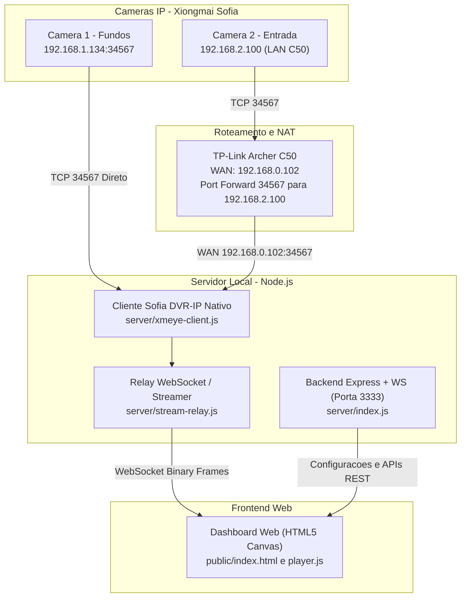
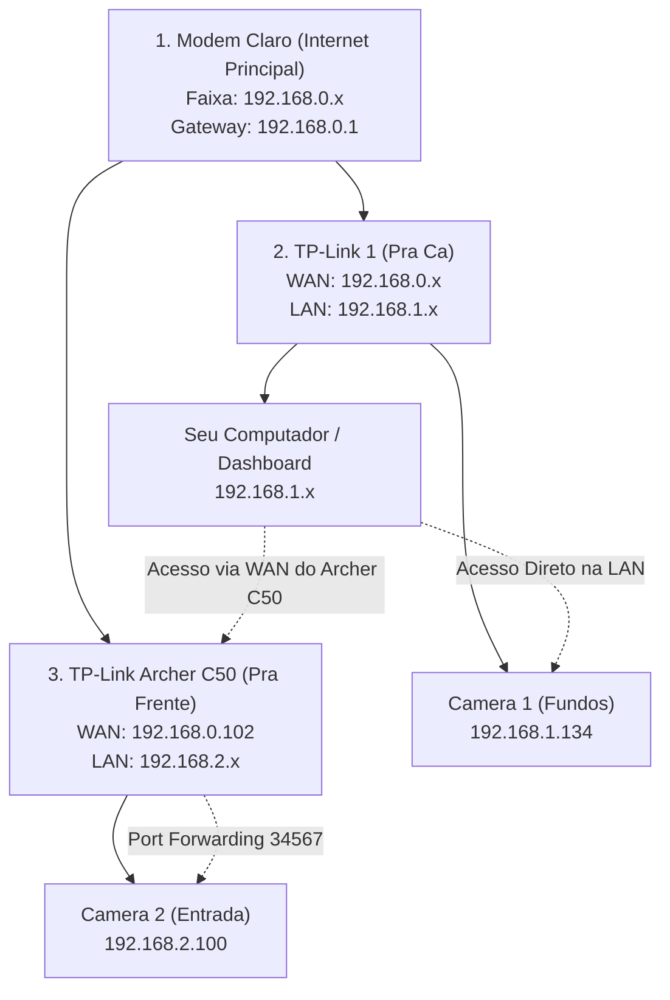

# 📚 Documentação Técnica — CFTV Dashboard Local

Documentação técnica aprofundada sobre a arquitetura, topologia de rede, protocolos de comunicação e endpoints do **CFTV Dashboard**.

---

## 🏗️ 1. Arquitetura do Sistema

O sistema é 100% autônomo e roda exclusivamente na rede local (LAN), sem envio de dados para a nuvem da XMeye ou servidores externos.



### Componentes Principais:
1. **[server/xmeye-client.js](file:///server/xmeye-client.js):**
   - Implementação nativa em JavaScript do protocolo binário **Sofia / DVR-IP** (porta TCP 34567).
   - Gerencia autenticação de sessão (`LOGIN_REQ` / `LOGIN_RESP` MsgId 1000) com senha em texto ou hash MD5 Xiongmai.
   - Captura snapshots em tempo real (`OPSNAP` MsgId 1560) em menos de 100ms.
2. **[server/stream-relay.js](file:///server/stream-relay.js):**
   - Transmissor de streaming contínuo.
   - Fornece quadros de alta fidelidade para os navegadores através de conexões WebSocket.
   - Monitora latência e estado de conexão (Health Check periódico via TCP).
3. **[server/config.js](file:///server/config.js):**
   - Carrega as variáveis do `.env`, trata caracteres especiais em senhas e centraliza endpoints.
4. **[public/js/player.js](file:///public/js/player.js) & [public/js/app.js](file:///public/js/app.js):**
   - Renderização em `<canvas>` acelerada via hardware (`createImageBitmap`).
   - Zoom digital em tempo real (1x a 4x com pan).
   - Captura instantânea de fotos em PNG.
   - Carregamento de configuração e metadados dinamicamente via `/api/config` (sem dados fixos no HTML).

---

## 🌐 2. Topologia de Rede & Desafio dos 3 Roteadores

O ambiente possui três roteadores em cascata com sub-redes isoladas por NAT/Firewall:



### Por que a Câmera 2 precisa de Port Forwarding?
- O **PC** está na sub-rede `192.168.1.x`.
- A **Câmera 2** está na sub-rede `192.168.2.x` atrás do roteador TP-Link Archer C50.
- Como o Archer C50 faz NAT, pacotes originados de fora da rede `192.168.2.x` são descartados por padrão.
- **Solução implementada:** No Archer C50, foi configurada uma regra de **Port Forwarding (Servidor Virtual)**:
  - **Porta Externa:** `34567`
  - **Porta Interna:** `34567`
  - **IP Interno:** `192.168.2.100` (IP da Câmera 2)
  - **Protocolo:** TCP
- Com isso, o PC se conecta ao endereço WAN do Archer C50 (`192.168.0.102:34567`), e o tráfego é entregue diretamente à Câmera 2.

---

## 📡 3. Protocolo Xiongmai Sofia (Porta 34567 vs RTSP 554)

As câmeras IP utilizadas são baseadas no chipset **Xiongmai (XM530V200_X2C-WQ_8M)**.

- **Porta 554 (RTSP):** Neste modelo e versão de firmware, o serviço RTSP clássico vem desabilitado de fábrica. Tentativas de conexão direta via RTSP resultam em `Connection Refused` ou erro 400.
- **Porta 34567 (Sofia / DVR-IP):** É o protocolo nativo de gerenciamento, vídeo e snapshot das câmeras XMeye.
  - O cabeçalho possui 20 bytes binários:
    - `0xFF` (Magic byte)
    - `Version` (1 byte)
    - `SessionId` (4 bytes LE)
    - `SequenceNumber` (4 bytes LE)
    - `TotalPackets` e `PacketIndex` (2 bytes)
    - `MsgId` (2 bytes LE)
    - `DataLength` (4 bytes LE)
  - Os comandos de autenticação (`LOGIN_REQ` 1000) e snapshot instantâneo (`OPSNAP` 1560) são executados diretamente por esse protocolo em poucos milissegundos.

---

## 🔌 4. Endpoints da API do Backend

O servidor Express escuta na porta definida no `.env` (padrão: `3333`):

| Método | Endpoint | Descrição | Formato |
| :--- | :--- | :--- | :--- |
| `GET` | `/` | Interface web da Central de Monitoramento | HTML / CSS / JS |
| `GET` | `/api/config` | Configurações públicas (nomes, IPs, portas, sem senhas) | JSON |
| `GET` | `/api/status` | Estado de conectividade TCP e latência de cada câmera | JSON |
| `GET` | `/api/check` | Força reteste em tempo real das conexões | JSON |
| `GET` | `/api/snapshot/:camId` | Captura foto HD instantânea da câmera (`cam1` ou `cam2`) | `image/jpeg` |
| `WS` | `/api/stream/:camId` | Canal WebSocket para streaming contínuo de quadros | Binário |

---

## ⚙️ 5. Dicionário de Variáveis de Ambiente (`.env`)

```ini
# Porta do Dashboard Web
PORT=3333

# Câmera 1 (Fundos)
CAM1_NAME=Fundos
CAM1_HOST=192.168.1.134
CAM1_PORT=34567
CAM1_USER=admin
CAM1_PASS=

# Câmera 2 (Entrada)
CAM2_NAME=Entrada
CAM2_HOST=192.168.0.102
CAM2_PORT=34567
CAM2_USER=admin
CAM2_PASS=
```

---

## 🆔 6. Identificadores dos Dispositivos

| Câmera | Local | Número Serial (Cloud ID) | Modelo Identificado |
| :--- | :--- | :--- | :--- |
| **CAM 1** | Fundos | `78a66737171ef282` | XM530V200_X2C-WQ_8M |
| **CAM 2** | Entrada | `d4cb35fba1f942cf` | XM530V200_X2C-WQ_8M |
